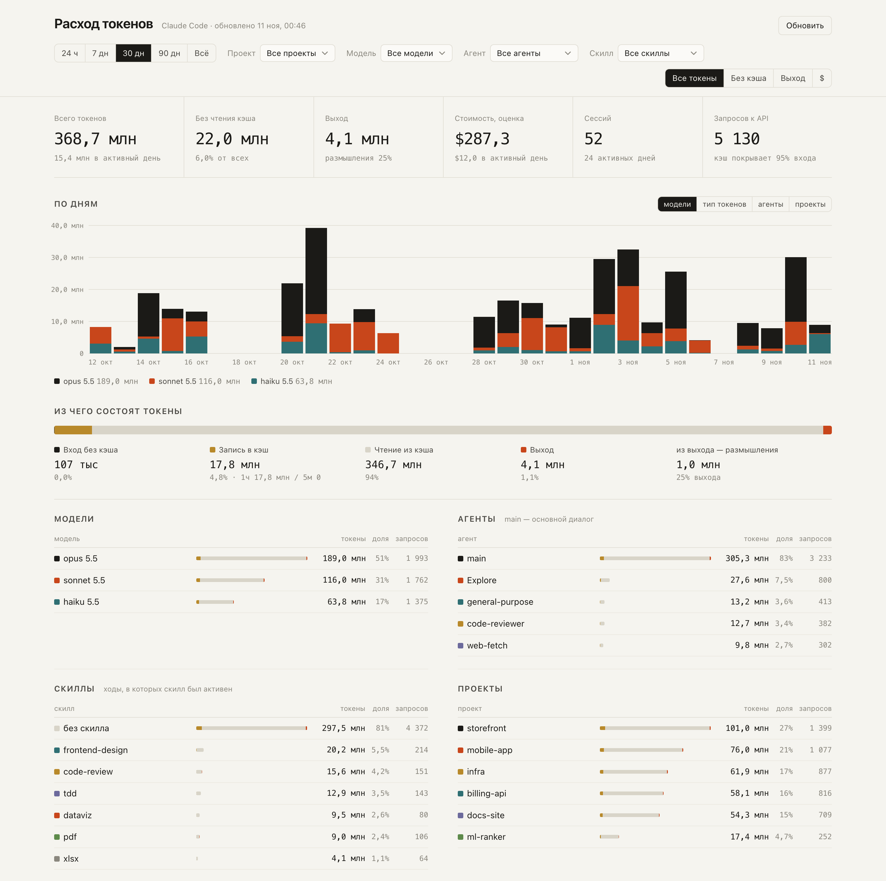
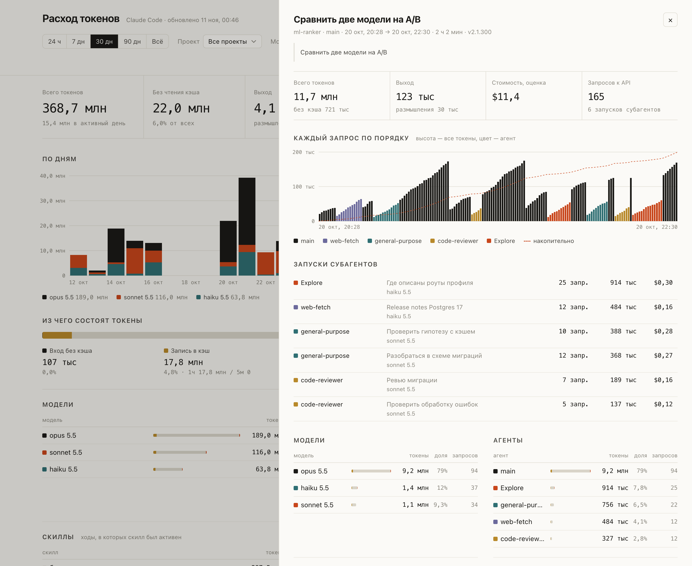

# token-usage

A local dashboard for Claude Code token usage, broken down by session, model, agent, skill, project and tool.

It reads the transcripts Claude Code already keeps in `~/.claude/projects/**/*.jsonl`. Nothing leaves your machine, and there are no dependencies to install: you only need Python 3.8+.

The interface is in Russian. [Описание на русском ниже ↓](#по-русски)

<picture>
  <source media="(prefers-color-scheme: dark)" srcset="docs/overview-dark.png">
  
</picture>

<sub>Screenshots use generated demo data, see <a href="#demo-data">Demo data</a>.</sub>

## Run

```bash
git clone https://github.com/UmarTuranov/token-usage.git
cd token-usage
python3 server.py --open
```

The dashboard is served at http://127.0.0.1:8765. On macOS you can also double-click `start.command`.

| Option | Default | |
|---|---|---|
| `--port N` / `PORT` | `8765` | port to listen on |
| `--open` | off | open the browser after starting |
| `CLAUDE_PROJECTS_DIR` | `~/.claude/projects` | where to read transcripts from |

**Обновить** (Refresh) re-reads the logs. A file is parsed again only if it has changed.

## What you see

- **Totals**: all tokens, tokens excluding cache reads, output tokens (with the share spent on thinking), estimated cost, sessions and API requests.
- **Daily chart**: stacked by model, token type, agent or project.
- **Token composition**: uncached input, cache writes (5 min / 1 h), cache reads and output.
- **Models, agents, skills, projects**: click a row to filter the whole dashboard by it.
- **Tools**: which tool calls the tokens went to.
- **Heatmap**: day of week × hour, in local time.
- **Sessions**: sortable and searchable. Click one to see every request in order, its subagent runs and the per-session breakdowns.

You can switch the main metric between all tokens, tokens excluding cache reads, output tokens and cost.

<picture>
  <source media="(prefers-color-scheme: dark)" srcset="docs/session-dark.png">
  
</picture>

## How it counts

- **Requests.** Claude Code writes one model response as several log lines that share a `message.id`. Those lines are merged into one request.
- **Agents.** `main` is the main conversation. Subagent runs are read from `<session>/subagents/agent-*.jsonl`, and their type comes from the `.meta.json` file next to each one.
- **Skills.** A skill counts as active from the moment it is invoked (through the `Skill` tool or a slash command) until your next message.
- **Tools.** A response's tokens are split equally between the tools it called.
- **Cost** is an estimate based on [`prices.json`](prices.json), in USD per 1M tokens. Cache reads and writes are priced as multipliers of the input price. Edit the file to match your plan; on a subscription, the number shows what the same usage would cost through the API.

## Demo data

To try the dashboard without your own logs, or to take screenshots without exposing them:

```bash
python3 demo/generate.py
CLAUDE_PROJECTS_DIR=demo/projects python3 server.py --open
```

The generator writes made-up projects, sessions, subagent runs and skill calls to `demo/projects`. It uses a fixed seed, so the output is the same every time, and the dates are relative to today.

## Privacy

- The server listens on `127.0.0.1` only.
- It rejects requests whose `Host` header isn't `localhost`, `127.0.0.1` or `::1`, which protects against DNS rebinding.
- The page loads no external scripts, fonts or analytics.
- `/api/data` includes session titles and the first prompt of each session, so be careful when sharing screenshots.

## Files

```
server.py        transcript parser and HTTP server (stdlib only)
public/          the page: index.html, app.js (aggregation, hand-written SVG charts), style.css
prices.json      prices used for the cost estimate
start.command    macOS launcher
demo/generate.py demo transcript generator
docs/            screenshots
```

## License

[MIT](LICENSE)

---

## По-русски

Локальный дашборд расхода токенов Claude Code по сессиям, моделям, агентам, скиллам, проектам и инструментам. Он читает логи из `~/.claude/projects` на вашем компьютере и никуда их не отправляет. Ничего ставить не нужно, достаточно Python 3.8+.

```bash
python3 server.py --open
```

Дашборд откроется по адресу http://127.0.0.1:8765. На macOS можно просто дважды кликнуть `start.command`.

Чтобы посмотреть дашборд на выдуманных данных: `python3 demo/generate.py`, затем `CLAUDE_PROJECTS_DIR=demo/projects python3 server.py --open`.

- Клик по строке в таблицах моделей, агентов, скиллов или проектов ставит фильтр на весь дашборд.
- Клик по сессии открывает её карточку: каждый запрос по порядку, запуски субагентов и разбивки.
- Скилл считается активным от его вызова до вашего следующего сообщения.
- Токены ответа делятся поровну между инструментами, которые в нём вызваны.
- Стоимость — оценка по `prices.json`. Поправьте тарифы под себя.
